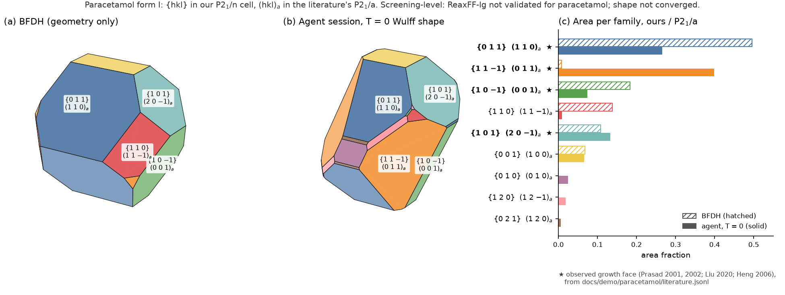
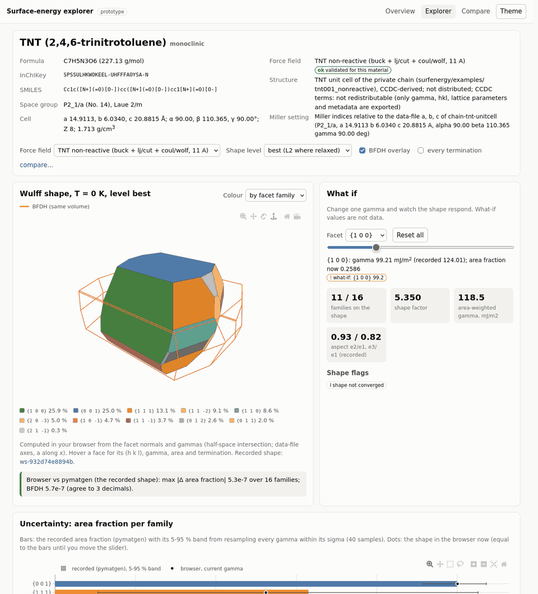
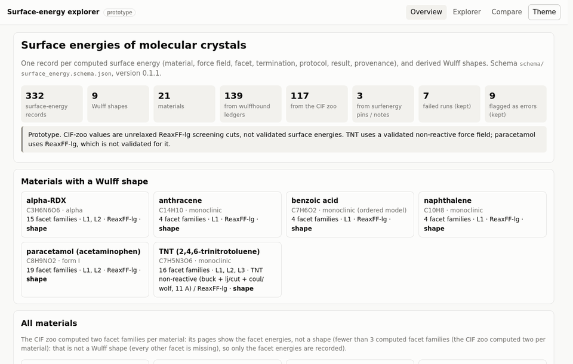
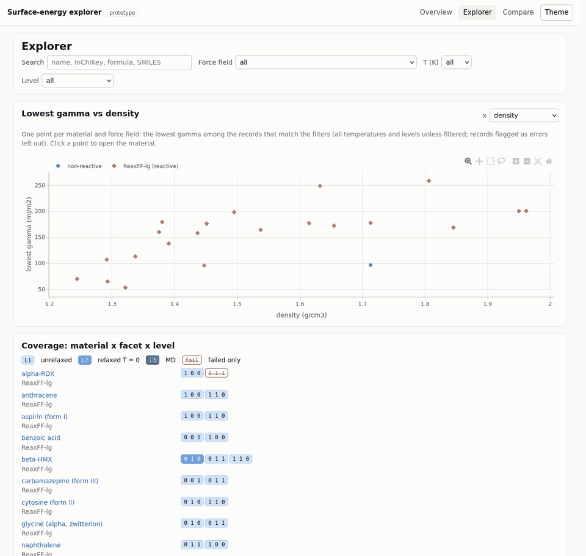
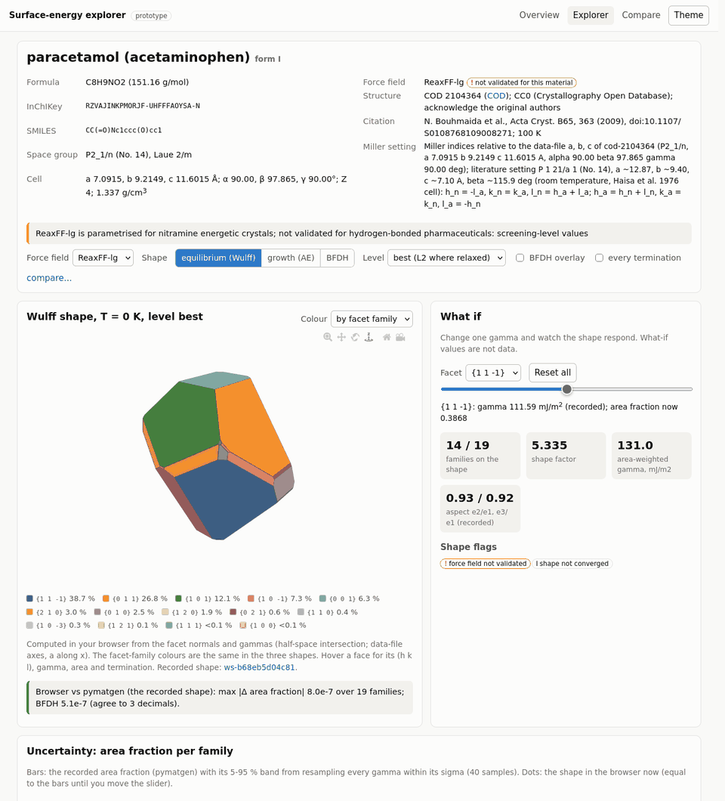
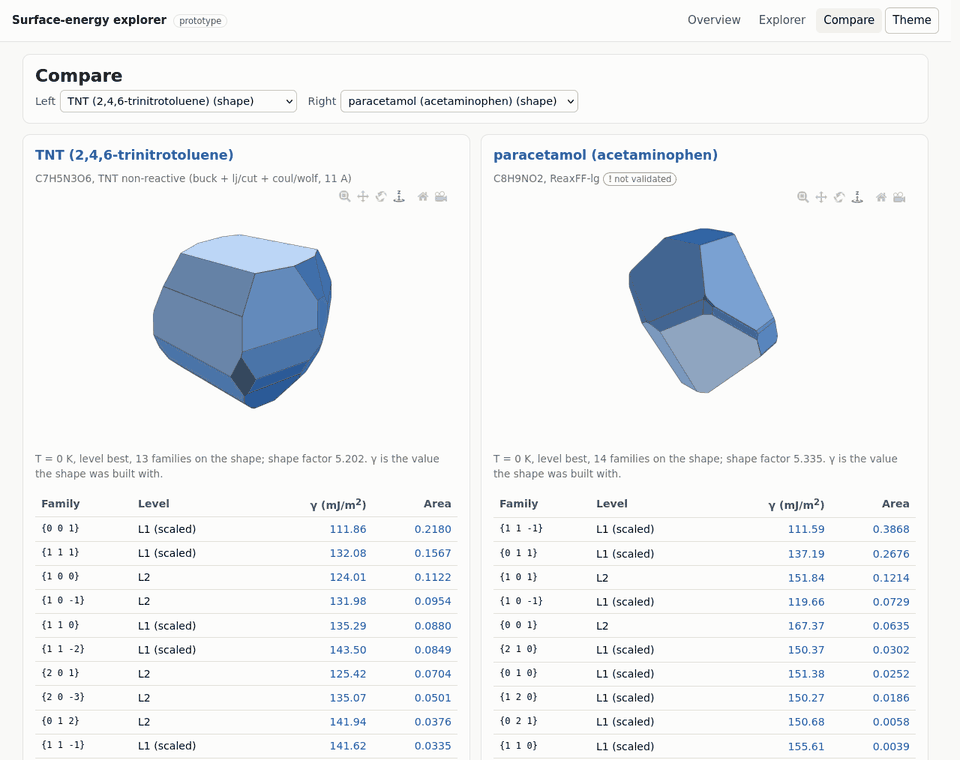
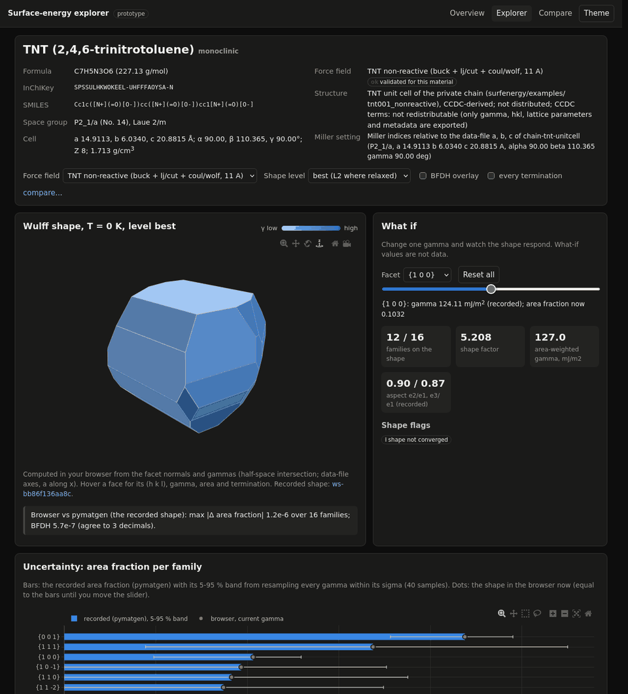
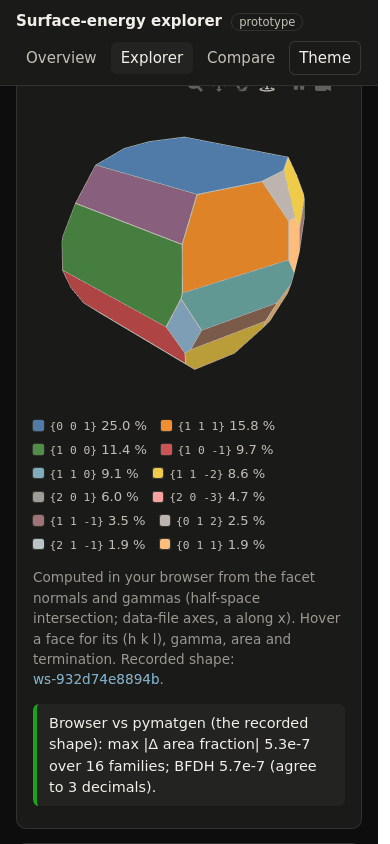
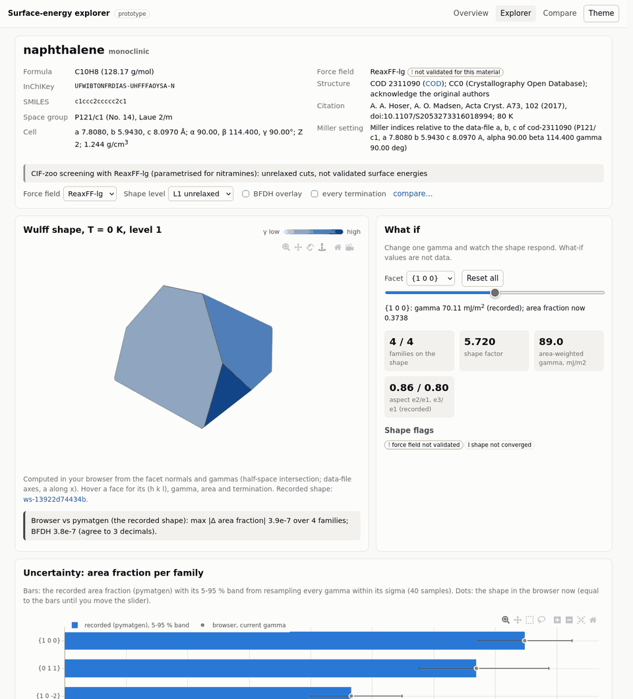
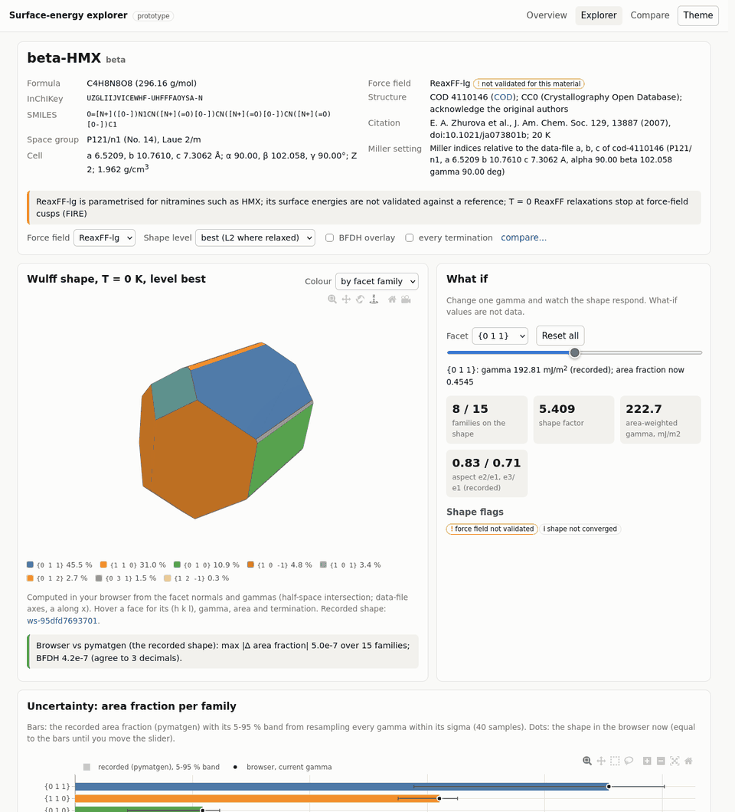

# wulffhound

**An AI agent that predicts a molecular crystal's shape, simulating only the facets that matter.**

A crystal's equilibrium (Wulff) shape needs the surface energy γ of every facet that could appear, and each γ is
a simulation: an oriented supercell, slabs for every termination, a relaxed surface energy. There are dozens of
candidate facets and the expensive ones cost minutes to hours each. In wulffhound an LLM agent (Claude Code)
drives deterministic tools through MCP. It screens broadly and cheaply, builds the Wulff shape, and spends the
expensive relaxations only on facets that are on the shape or could get there within their uncertainty. It
recovers from tool failures and stops when the shape has converged. With MCP Bond (optional) it also pulls
observed habits and published surface energies from the literature, converts their Miller indices into our cell
setting, and compares.

The split is strict. **The physics is in deterministic tools. The LLM decides, recovers and explains, and it never
produces a number.** Every γ in the report comes from a run with provenance: run id, inputs, md5 of the data file
and script, cached or live.

## Results



**Paracetamol form I.** The four observed growth faces from the literature are four of the five largest
computed families: {1 1 -1}, {0 1 1}, {1 0 1} and {1 0 -1} in our P2_1/n setting, which are (0 1 1), (1 1 0),
(2 0 -1) and (0 0 1) in P2_1/a. BFDH gives {1 1 -1} = (0 1 1)_a almost no area (0.0079). On the T = 0 shape it is
the largest family (0.3987). These numbers are screening-level (see below), and the shape is not converged.
Regenerate the figure with `./wh py tools/make_headline.py`, a replay of the demo session.

**TNT.** The T = 0 shape is compact and has many facets (15 families). {0 0 1} is still the largest, but at 22 %
of the area, against 59 % on the BFDH plate ([shape](docs/tnt_wulff.png), [BFDH](docs/tnt_bfdh.png)).

**Cost of the demo sessions.** These numbers are CPU charged, live / cached.
- Paracetamol: 18.2 min (0.9 / 17.3), 32 turns, USD 1.03.
- TNT: 23.6 min (1.9 / 21.7), 40 turns, USD 1.59.

## What the agent adds (and what it does not)

- **The deterministic baseline is the control.** It runs under the same budget and live-run allowance. On allocation
  it reached the same on-shape families as the agent did (TNT: the agent also has a 0.0002 sliver of {2 1 0}), and
  the agent used 5-11 CPU min less. So choosing facets is not where the LLM shows its value here.
- **What the LLM adds:**
  - Literature grounding through Bond, with the Miller indices converted between settings.
  - Reading the consistency guard and the failures, and explaining them.
  - A written report that cites its sources.
- **The shapes are not converged.** The demo did not allow live level-2 runs. The expensive runs come from a
  precomputed cache, and the agent decides which of them to use.
- **Paracetamol's force field (ReaxFF-lg 2011) is not validated** for paracetamol, so its results are
  screening-level.

## What it does

| Level | What | Tool | Cost |
|---|---|---|---|
| 0 | d_hkl with systematic extinctions, BFDH rank and shape | `list_candidate_facets`, `build_wulff level=0` | free |
| 1 | unrelaxed γ of every termination (supercell + slabcutter screening, lowest kept) | `screen_facet(s)` | ~0.5-1 CPU min |
| 2 | relaxed T = 0 γ (bulk + slab minimisations) | `relax_facet` | ~2-7 CPU min |

MCP tools (`wulffhound/mcp_server.py`, stdio): `material_info`, `list_candidate_facets`, `estimate_cost(s)`,
`screen_facet(s)`, `relax_facet`, `build_wulff`, `log_decision`, `add_literature`, `get_report_path`. The
`build_wulff` tool uses pymatgen `WulffShape` on the data-file lattice, and every build checks the Miller and
Laue conventions against pymatgen. It returns:

- the area fractions;
- for each off-shape family, the γ reduction it would need to appear;
- a resampling of every γ within its σ;
- the **next most informative facet** (relevance × information gain / CPU minutes);
- the **stop rule**: every on-shape family at level 2, area std < 0.02, nothing within 1 σ of appearing, and every
  family on the BFDH shape computed.

Every session gets a self-contained HTML report with 3D shapes, a facet table with provenance, the decision log
and the literature. There is also a deterministic **baseline** policy (`./wh baseline`, `./wh compare`) that runs
under the same budget, so you can see what the LLM adds.

Materials:

- **TNT** (`tnt`): monoclinic, Z = 8, a validated non-reactive force field, unit-cell route.
- **Paracetamol form I** (`paracetamol`): COD 2104364, P2_1/n. CIF route through cif2lammps and ReaxFF-lg 2011,
  which is **not validated** for paracetamol, so these results are screening-level. Our cell is in P2_1/n; the
  morphology literature mostly uses P2_1/a. `material_info.setting_map` and `AGENT.md` give the conversion the
  agent must show: h_n = -l_a, k_n = k_a, l_n = h_a + l_a.

## Quickstart (replay mode: no simulation chain needed)

```bash
git clone https://github.com/ethanholbrook/wulffhound && cd wulffhound
micromamba create -n wulffhound -f environment.yml && micromamba activate wulffhound   # or conda/mamba
./wh selftest                          # TNT: every MCP tool from Python + replay of the MVP session: "ALL OK"
./wh --material paracetamol selftest

# the agent (Claude Code, headless), replay only: every result comes from the committed bundle
export WULFFHOUND_REPO=$PWD WULFFHOUND_MATERIAL=tnt
./wh reset
MCP_TOOL_TIMEOUT=900000 claude -p "$(cat PROMPT_tnt.md)" \
  --mcp-config mcp.nobond.json --strict-mcp-config \
  --allowedTools "mcp__wulffhound__*" --tools "" --max-turns 80 \
  --output-format stream-json --verbose > state/tnt/agent_transcript.jsonl
./wh transcript state/tnt/agent_transcript.jsonl state/tnt/agent_transcript.txt
./wh compare                           # the deterministic baseline under the same budget, then the agent report
xdg-open state/tnt/report.html         # (open on macOS)
```

For paracetamol, set `WULFFHOUND_MATERIAL=paracetamol` and use `PROMPT_paracetamol.md`. For an interactive
session, run `claude --mcp-config mcp.nobond.json --strict-mcp-config` and paste the prompt. `wh` finds Python
in this order: `$WULFFHOUND_PY`, the active conda/micromamba env, `~/micromamba/envs/wulff-dev`.

In replay mode a facet that is not in the bundle is refused with a clear message, and the agent reports what the
run would cost. The committed bundle (`data/<material>/ledger.json`) holds the following for each result: the γ
values (relaxed and unrelaxed), level, hkl, search_range, n_periods, the screened terminations,
faces_equivalent, molecules intact, CPU seconds, the md5 of the inputs, and the chain's run id as a provenance
string. Replaying the TNT agent session from the bundle gives the same area fractions, to 4 decimals, as the
original build (checked by `./wh selftest`).

## Live mode (needs the simulation chain)

Live runs call the simulation chain: the Sim2L tools supercell (GCCM), slabcutter, surfenergy and cif2lammps
around LAMMPS. The chain is in surface-energy-sim2ls (private for now; the tools are headed for nanoHUB). It is not part of this repository.

```bash
export WULFFHOUND_CHAIN_ROOT=/path/to/surface-energy-sim2ls   # default: $SIM2L_DEV_ROOT, else ../surface-energy-sim2ls
export WULFFHOUND_CHAIN_ENV=/path/to/its/sim2l/env          # default: ~/micromamba/envs/cif2lammps-dev
export WULFFHOUND_LIVE_RUNS=2 WULFFHOUND_LIVE_LEVEL=1 WULFFHOUND_LIVE_MAX_MIN=1.5   # optional live-run allowance
```

The tools enforce every limit, so the agent cannot talk its way past them:

- `WULFFHOUND_BUDGET_MIN` (default 30) is the session's CPU budget. A replay from the cache is charged its
  recorded CPU time, so the agent and the baseline compete on the same budget.
- `relax_facet` refuses any run whose estimate exceeds `max_minutes` (default 6).
- The optional live-run allowance caps the number, level and estimated size of live runs.
- `./wh import` rebuilds the replay bundle from the chain (`tools/build_bundle.py`).

## MCP Bond (literature, optional)

```bash
export BOND_MCP_URL=...  BOND_TOKEN=...      # from your environment only; never written to a file
claude -p "$(cat PROMPT_tnt.md)" --mcp-config mcp.example.json --strict-mcp-config \
  --allowedTools "mcp__wulffhound__*" "mcp__bond__*" ...
```

`mcp.example.json` sends `Authorization: Bearer ${BOND_TOKEN}`, which Claude Code expands from the environment.
Literature goes into a separate "from papers" column with citations. It only steers what is computed and what the
result is compared with; it is never used as a γ.

## How the agent is kept honest

- **It never produces a number.** Every γ, area fraction, cost and score comes from a tool result with
  provenance. `AGENT.md` (sent as the server's instructions) forbids anything else, and the final answer can be
  checked against the transcript: in the MVP TNT session, all 68 decimal numbers in the answer appear literally
  in tool results.
- **Limits are enforced by the tools**, not requested in the prompt: the CPU budget, `max_minutes`, the live-run
  allowance, and cached-only/replay mode.
- **A deterministic consistency guard** covers every material. A level-2 result whose relaxed γ exceeds its
  unrelaxed γ by more than 1 mJ/m² (a T = 0 minimisation cannot raise the energy), or whose molecules did not
  stay intact, is marked inconsistent. It is left out of `build_wulff` by default: the level-1 value is used and
  flagged, and the agent gets the reason. A non-positive γ is rejected too. Examples from paracetamol:
  - surfenergy's own {0 0 1} value, relaxed 247.2 vs unrelaxed 169.2 mJ/m², fails the guard. It is reported as
    superseded, and the FIRE re-relaxation of the same run (167.4) is used.
  - {1 0 -1}, relaxed 124.0 vs unrelaxed 121.6 mJ/m² even after FIRE, is excluded, and its level-1 value is
    used (flagged).
  - A 3-period thickness check of {1 0 -1} (surfenergy value -4.8) is listed as a rejected run.
- **The force-field status is part of the result.** `material_info.forcefield_validated` is true for TNT and
  false for paracetamol, and the report header says so.
- **Every decision is logged** (`log_decision`, with expected cost and outcome), and every skip is costed.

## Demo runs (22 Oct 2026, headless Claude Code + MCP Bond)

`docs/demo/<material>/` holds one headless `claude -p` session per material, run with Bond and a small
live-run allowance (`WULFFHOUND_LIVE_RUNS=2 WULFFHOUND_LIVE_LEVEL=1 WULFFHOUND_LIVE_MAX_MIN=1.5`, budget 30 CPU
min), so most results are cached replays. Each folder has the readable transcript (`agent_transcript.txt`; Bond
results are cut to 600 characters because they carry third-party abstracts), the final answer, the report
(`report.html`, plotly from its CDN), the decision log, the literature log and `./wh compare` against the
deterministic baseline. `tools/publish_demo.sh MATERIAL` regenerates a folder from `state/`.

| | TNT | paracetamol form I |
|---|---|---|
| largest families (area fraction) | {0 0 1} 0.219, {1 1 1} 0.142, {1 0 0} 0.099, {1 0 -1} 0.097 | {1 1 -1} 0.399, {0 1 1} 0.266, {1 0 1} 0.133, {1 0 -1} 0.074, {0 0 1} 0.065 |
| families on the shape | 15 | 13 |
| CPU charged (live / cached) | 23.6 min (1.9 / 21.7) | 18.2 min (0.9 / 17.3) |
| live runs | {1 1 2} 148.16, {2 1 -2} 160.53 mJ/m² | {0 1 3}, {1 1 -3}: both failed (chain crash, recorded) |
| literature via Bond | 5 entries, no indexed faces for pure monoclinic TNT | 9 entries, every (hkl) converted P2_1/a -> P2_1/n |
| turns, cost | 40 turns, USD 1.59, 5 min wall | 32 turns, USD 1.03, 4 min wall |

Both sessions stop with `converged: false` and say why (no live level-2 runs allowed). Every decimal in both final
answers is in a tool result. The paracetamol session reports the unvalidated force field, the guard's rejection
of {1 0 -1} at level 2 and the superseded raw {0 0 1} value. Its four observed growth faces in our setting
({1 1 -1}, {0 1 1}, {1 0 1}, {1 0 -1}) are four of its five largest computed families, while BFDH gives {1 1 -1}
almost no area. The agent's shapes match the baseline's on-shape sets (TNT: plus a 0.0002 sliver of {2 1 0})
at 5-11 CPU min less.

## Dataset and dashboard (prototype)

A first cut of the open surface-energy dataset and of a morphology dashboard that reads it. It is an opt-in layer:
it only reads exported data, and the simulation chain and the agent are unchanged.



**What is in it** (`dataset/`, built by `tools/export_dataset.py`, schema 0.1.1):

| Source | Records | What |
|---|---|---|
| wulffhound ledgers, `data/tnt` and `data/paracetamol` | 55 + 84 | level 1 (one record per computed termination group) and level 2, with the failed runs |
| the chain's CIF zoo (`notes/validation/cif_zoo.json`, read from the private chain) | 117 | 21 COD crystals x 2 facet families, the unrelaxed gamma of every termination (ReaxFF-lg), 2 failed facets |
| surfenergy's pinned values and notes | 3 | TNT (0 0 1) T = 0 (104.02) and 300 K (96.8 +- 5.7, default MD length), beta-HMX (0 1 0) T = 0 on the COD 4110146 cell (226.07, with its run id) |
| campaign driver, `dataset/campaigns/*.jsonl` (see [Campaign driver](#campaign-driver)) | 5 + 8 | TNT level 2 with the R3 slab start (4 values, 1 failed run); level 1 of two more families of naphthalene, anthracene and benzoic acid |
| derived Wulff shapes | 7 | TNT and paracetamol at level `best` and level 1 (pymatgen, the wulffhound engine); naphthalene, anthracene and benzoic acid at level 1 (built from their records, `wulffhound/shapes.py`) |

In all: 272 surface-energy records for 21 materials. 7 are failed runs and 2 are level-2 results that the
consistency guard rejects. They are kept, with their flags. Parquet is skipped because pyarrow is not installed
in the dev env (`dataset/index.json` says so). `index.json` lists what was not taken: the short test-length MD
values of surfenergy (not stationary, no run id), the older-protocol pins, and the 4 zoo CIFs that cif2lammps
rejects as expected. The zoo has only two facet families per material, which is not a Wulff shape, so for those
materials the dataset records the facet energies and no shape, and the dashboard says so; a material gets a
level-1 shape once it has three or more families that enclose a bounded shape (the three campaign crystals).

**Schema** (`schema/surface_energy.schema.json`, JSON Schema 2020-12). The unit of record is one surface energy:

- `material`: InChIKey, SMILES, name, polymorph, the structure with its source and licence, space group, cell, density.
- `force_field`: name, version, md5, validated or not.
- `facet`: hkl, family and its Laue orbit, d_hkl, d_eff, and the Miller setting of the record's own cell.
- `termination`: index, group, faces_equivalent, lowest or not.
- `protocol`: level (unrelaxed / relaxed T = 0 / MD), T, n_periods, vacuum, slab_from, minimiser, MD lengths, cell.
- `result`: gamma, error and error method, stationary, `gamma_flags` (code, severity, detail, who raised it), unrelaxed and raw values.
- `provenance`: source entry, Sim2L and revision, run id, child run ids, input md5s, date, venue, CPU, a reproduce line.

A derived `wulff_shape` record covers one material x force field x T x level x facet set. It holds each family's
gamma, sigma, area fraction, 5-95 % sensitivity band, BFDH area and input record ids, plus the shape metrics
(shape factor, anisotropy, aspect ratios) and the convention checks (2/m orbits asserted at symprec 1e-5 and 1e-3).
The exporter validates every record and fails if any is invalid.

**Dashboard** (`dashboard/`: static HTML + JS, no build step, plotly.js 2.35.2 from jsDelivr):

- **Material page.** The facet table: gamma +- error, level, termination, flags, and every value linked to its
  record and run. The Wulff shape is **computed in the browser** (`dashboard/js/wulff.js`, half-space intersection
  on the data-file lattice). Hover a face for its hkl, gamma, area and termination. You can overlay the BFDH shape,
  move a what-if slider (one gamma, live redraw), and view area bars with the recorded sensitivity bands.
- **Explorer.** Search by name, InChIKey, formula or SMILES; filter by force field, T and level; plot the lowest
  gamma against density or molecular mass; and see a coverage map of material x facet x level.
- **Compare.** Two materials side by side.
- **Record and shape pages.** The full provenance of every number.

```bash
./wh py tools/export_dataset.py                 # rebuild dataset/ (reads cif_zoo.json from $WULFFHOUND_CHAIN_ROOT)
tools/serve_dashboard.sh                        # http://127.0.0.1:8765/dashboard/
python tools/test_dashboard.py --screenshots    # headless Firefox + selenium (an env with both; plotly from the CDN)
```

The headless test passes with 0 failures. Every page loads with no JS errors, and the TNT shape renders. The
browser area fractions equal pymatgen's to within 1.2e-6 for all 4 shapes (the BFDH ones to 6e-7). The slider
changes the shape: {1 0 0} at 0.8 gamma goes from 0.103 to 0.254. There is no horizontal scroll at 390 px.

| | |
|---|---|
|  |  |
|  |  |
|  |  |

**Limits.**

- This is a prototype, schema 0.1.1 (0.1.0 plus the campaign source and the sim2l_flag code).
- The CIF-zoo values are **unrelaxed ReaxFF-lg screening cuts, not validated surface energies**.
- TNT uses a **validated non-reactive force field**. Paracetamol uses **ReaxFF-lg, which is not validated** for it.
- The shapes are T = 0 shapes and are not converged (flagged).
- The TNT shape uses the ledger only, the same as the agent's engine, so surfenergy's re-cut {0 0 1} T = 0 value
  is in the dataset but not in the shape.
- The surfenergy records have no run id (flagged `no_run_id`).
- Run folders are cited by id (`chain:...`) and are not shipped.
- No atomic coordinates are exported. The CCDC-derived TNT and HMX cells contribute only gamma, hkl, lattice
  parameters and metadata.

## Campaign driver

The driver runs **campaigns**: materials x facets x levels x temperatures, under one force-field route, protocol,
CPU budget and policy. It plans, runs the chain, and turns every finished job into dataset records. It is an
opt-in layer. **The core force-field routes stay the defaults and work exactly as before.** These are ReaxFF
(`reaxff`, a ReaxFF file, e.g. reax-lg-2011 through cif2lammps) and the non-reactive typed route (`nonreactive`, a
data file with full topology plus its run-0 script, as for TNT). The driver only calls them, with the inputs the
tools already accept. An override is passed only when the spec gives it; otherwise each tool's own default applies.

```bash
./wh campaign plan   campaigns/zoo_screen.yaml   # dry run: jobs, est. CPU, what is skipped and why
./wh campaign run    campaigns/zoo_screen.yaml   # plan, run (journal, resumable), ingest, rebuild dataset/
./wh campaign status campaigns/zoo_screen.yaml   # the journal: gamma, gamma_flags, errors, CPU
./wh campaign ingest campaigns/zoo_screen.yaml   # journal -> dataset/campaigns/<name>.jsonl -> tools/export_dataset.py
./wh py -W ignore -m unittest discover -s tests  # 39 unit tests (planner, executor, ingest, shapes), no chain needed
```

**Spec** (YAML or JSON, `schema/campaign.schema.json`):

```yaml
campaign: zoo_screen
materials: [naphthalene, anthracene, benzoic-acid]   # name / material_id / InChIKey, {cif: PATH}, {example: DIR}
forcefield: {route: auto}           # auto | reaxff (ffield) | nonreactive (datafile + script); more routes register
facets: {select: bfdh_top, n: 6, limit_new: 2}       # or a list, 'bfdh_top_N', 'max_index K', on_shape, wulff_priority
# level_facets: {"2": {select: wulff_priority, target_ok: 10}}   # optional: another selection for one level
levels: [1]                         # 1 unrelaxed, 2 relaxed T = 0, 3 MD at T (md: equilibration_ps, production_ps, n_blocks)
temperatures: [0]
protocol: {n_periods: 2, search_range: 4}            # also slab_from, vacuum, angle_dev, s_tol, cell_fallbacks
budget: {cpu_minutes: 15, per_run_cap_minutes: 3}
policy: baseline                    # exhaustive | baseline (greedy) | agent (plan only: the MCP agent's queue)
executor: {backend: local, workers: 2}               # local | nanohub | aura; workers capped at 2
```

**Planner** (`wulffhound/campaign.py`):

- *Materials.* A material resolves to a wulffhound bundle (tnt, paracetamol), a CIF-zoo crystal of the chain, a
  chain example folder, or a CIF. A CIF goes through cif2lammps with surfenergy's CIF defaults, cached; if the unit
  cell is one the dataset knows, it maps to that material.
- *Force-field routes.* `FORCEFIELD_ROUTES` holds `reaxff` and `nonreactive`. A future route (e.g. OpenFF)
  registers one more function with `register_route` and changes neither of these.
- *Look before you run.* A job is skipped when its exact key is already in the dataset or in this campaign's
  journal, and the record ids are named. The key is material, structure, force field, family, level, T,
  n_periods, slab_from, vacuum and MD lengths. A record with the same material, family and level but another
  protocol is reported as a near-duplicate, and the job runs as a refresh. A key that failed before is not
  retried unless `dedup.retry_failed` or `--retry-failed` says so. `retry_failed: other_cell` retries it only with
  another oriented cell (hkl member, search_range, angle_dev) than every one it failed with.
- *Facet selections.* `level_facets` gives one level its own selection. `wulff_priority` ranks on a shape of the
  material (`shape_level`, default 1): the families on it (tier 0), those within its uncertainty (tier 1: on the
  shape in some sensitivity samples, or appearing when their gamma drops by `k_sigma` x sigma, default 2), then
  the rest of its facet set in BFDH order (tier 2). Without that shape, or while lower-level jobs of the material
  are still planned, the level's jobs are deferred; `run` then re-plans after the ingest (staged, at most 6
  stages, one budget). `target_ok N` runs jobs only until N families of the selection have a value: failed or
  refused ones do not count, so the next family takes their place.
- *Cost.* Bundle materials use the engine's calibrated model, on measured cells. Every job also gets surfenergy's
  own estimate (its GUI model, `wulffhound/chain_estimate.py` in the chain env). For other materials that estimate
  is used, and it picks the family member with the smallest oriented cell. For a ReaxFF route the estimate also
  applies slabcutter's own memory rule (`check_reaxff_size`: the far-neighbour reservation of the whole oriented
  cell against its 8 GB limit), so a cell slabcutter would refuse is not planned. `protocol.cell_fallbacks` lists
  further (search_range, angle_dev) settings, tried in order when a setting has no cell, a refused cell or an
  estimate over the cap; a member whose cell failed before is passed over. Jobs with no usable cell, or over the
  per-run cap, are skipped. The budget counts the CPU this campaign has already spent.
- *Order and budget.* `exhaustive` runs in the spec's order. `baseline` is the deterministic greedy policy: level 1
  in BFDH order, then the higher levels by (area on the current shape) / (CPU). The plan is then cut at the budget.

**Executor** (`wulffhound/campaign_exec.py`):

- *Backends.* `local` runs the chain through `chain_runner.py`, the engine's live-run mechanism. `nanohub` would
  call `simtool.Run` on installed revisions, with venue and cluster options. `aura` would call the AURA MCP's
  `run_sim2l`. Both are documented, tested stubs. The Sim2Ls are not on nanoHUB yet, so they raise
  `BackendNotAvailable`, list what is needed, and show the exact call through `describe(job)`.
- *Workers.* Default 1, at most 2.
- *Journal.* `state/campaigns/<name>/journal.jsonl`. A job left `started` by a crash is recovered from its
  `result.json` (the chain runs in its own session and finishes), or else run again.
- *Failures.* A failed job is recorded with the tool's error text and is not run again. A gamma that surfenergy
  flags keeps its `gamma_flags`.
- *Recalibration.* Estimates are recalibrated while the campaign runs: once jobs of a level have finished, later
  estimates are scaled by the median measured/estimated CPU (only upwards). The per-run cap and the budget are
  checked again on the scaled value.

**Ingest** (`wulffhound/campaign_ingest.py`):

- *Records.* Every done or failed job becomes schema-valid `surface_energy` records (provenance source
  `campaign`) in `dataset/campaigns/<name>.jsonl`. Each record has:
  - the run id (surfenergy's run hash, or the job folder for a level-1 screen) and the child run ids;
  - the revision `chain <short sha>`, marked `+dirty` when the chain's tools had uncommitted changes;
  - the md5 of the data file, script and force-field file, and the CPU and wall time;
  - the reproduce line (`./wh campaign run SPEC --only JOB_ID ...` plus the chain call);
  - surfenergy's `gamma_flags`, mapped to dataset flags, and the wulffhound consistency guard.
- *Dataset.* `tools/export_dataset.py` reads the stores. A campaign level-2 value of a bundle material enters that
  material's `best` shape: the newer run wins, as in the engine. A refreshed ledger record names the record that
  refreshes it in its `protocol_superseded` flag. Other materials get a level-1 shape from their records
  (`wulffhound/shapes.py`) once they have three or more families that enclose a bounded shape and whose Laue
  orbits equal pymatgen's lattice symmetry, with as many operations as the Laue class of the space group (2/m 4,
  mmm 8) at symprec 1e-5 and 1e-3. Once they also have level-2 records they get a `best` shape by the engine's
  rule: the relaxed T = 0 value where a family has one that passes the guard, else its level-1 value x the mean
  relaxed/unrelaxed ratio; sigma max(gamma_error, 2 %) and (std of the ratios + 2 %, floor 5 %). A material
  from a CIF that is neither a bundle nor a zoo entry gets its Laue class from its spglib point group
  (`symmetry.laue_class`, e.g. -42m -> 4/mmm), so the operation-count check applies to it too. In a `best` shape,
  a level-2 record without d_eff (a surfenergy pin) takes d_eff from its family's level-1 record, so the BFDH
  overlay is the same as at level 1 (both added 2026-10-23 for the production campaigns). The dashboard picks all of it up, and `tools/test_dashboard.py` checks
  a campaign record and a campaign-completed shape.
- *MCP.* `campaign_plan(spec)` and `campaign_status(spec)` in `mcp_server.py` let the agent plan with the driver.
  Both only read.

**First campaigns (23 Oct 2026, chain 6b9edf5 with another agent's uncommitted surfenergy changes, so the records
say `chain 6b9edf5+dirty`; TNT uses cut-off electrostatics, which those changes leave as before):**

| Campaign | Jobs | CPU | Result |
|---|---|---|---|
| `tnt_t0_relax`: level 2 at T = 0, slab_from relaxed_bulk, for TNT's on-shape families | 5 run (in 3 `run` calls), 8 skipped | 22.2 min | {1 0 0} 124.01 (static cut 124.11); {1 0 -1} 131.98 (first level 2; unrelaxed 136.90); {2 0 -3} 135.07 (first level 2; unrelaxed 138.58); {1 0 -2} 138.29 (first level 2; unrelaxed 145.12); {2 0 1} failed: the relaxed bulk has 4 terminations and the static cell 2, so surfenergy refuses the re-cut and names slab_from static_cut |
| `zoo_screen`: level 1 of the next two BFDH families of three zoo crystals (ReaxFF-lg) | 6 run, 12 skipped | 3.2 min | naphthalene {1 1 0} 121.75, {1 0 -2} 89.22; anthracene {0 1 1} 113.12, {1 1 -1} 99.58; benzoic acid {1 0 -2} 102.41, {0 1 1} 183.70 |

- *TNT skips.* {0 0 1} was skipped because it is in the dataset: surfenergy's R3 pin 104.0232. Five families were
  over the 6-minute cap at plan time.
- *Recalibration.* The first runs took 1.57 x their estimate (likely R3's second slabcutter pass and the bulk stress
  steps, which the engine's calibration runs predate). After the recalibration, {0 1 2} (8.0 min) and {2 1 -1}
  (6.9 min) were over the cap.
- *Resume.* The first `run` was stopped on purpose with two jobs in flight. Those chain runs finished on their own,
  and the next `run` recovered both from their `result.json` files.
- *A new on-shape family.* The refreshed shape put {1 0 -2} on it (0.011). A later re-plan picked it up, estimated
  at 5.5 min after the recalibration; it took 6.3 min.
- *Refreshed records.* Of the four TNT level-2 records flagged protocol_superseded, {1 0 0} is refreshed, and its
  flag names the new record. {2 0 1} fails under R3. {0 1 2} and {0 1 1} are over the time rule.
- *TNT flags.* {1 0 0}, {1 0 -1} and {1 0 -2} carry surfenergy's `minimisation_not_converged` flag, a warning:
  the bulk stress was 41, 54 and 139 atm against a 25 atm tolerance.
- *TNT shape.* The `best` shape now has 13 families on it (12 before). {1 0 0} grows from 0.103 to 0.112.
  {2 0 -3}, now at level 2, falls from 0.072 to 0.050. {1 0 -2} appears at 0.011.
- *New zoo shapes.* The three crystals reach four families each and get their first (screening-level) shapes:
  - naphthalene: {1 0 0} 0.374, {0 1 1} 0.334, {1 0 -2} 0.233, {1 1 0} 0.059;
  - anthracene: {1 0 0} 0.384, {1 1 -1} 0.377, {0 1 1} 0.238; BFDH gives {1 1 -1} only 0.107;
  - benzoic acid: {0 0 1} 0.519, {0 1 1} 0.173, {1 0 -2} 0.168, {1 0 0} 0.141.



**Limits.**

- `local` is the only backend that runs. The level-3 (MD) path is implemented and unit-tested but has not been
  run here: it is longer than the time rule.
- A level-2 job adds no new level-1 records: the screening of every termination is in its run, and its unrelaxed
  gamma is in the record.
- The engine (the MCP agent's tools) does not read campaign records as its cache yet. The planner does, and so
  does the exported dataset.
- Shapes built from records are level 1 only, with sigma 5 %.

## Honest limits

- **T = 0 only**: static surface energies, the standard Wulff input. No entropy and no finite-temperature shape.
- **The Wulff shape is the equilibrium shape**, not the growth habit (solvent, supersaturation, kinetics). Compare
  them; do not expect them to be equal.
- **TNT**: a validated non-reactive force field. **Paracetamol**: ReaxFF-lg 2011 is parametrised for nitramine
  energetic crystals and not validated for hydrogen-bonded pharmaceuticals, so the paracetamol numbers are
  screening-level and the facet ranking matters more than absolute γ. Its T = 0 ReaxFF relaxations are
  minimiser-limited. Where the chain's paracetamol study re-relaxed a run with FIRE (fixed box), the bundle uses
  that value and keeps surfenergy's own value as `gamma_surfenergy_raw`. After FIRE, {0 0 1} (167.4) and
  {1 0 1} (151.8) are used at level 2. {1 0 -1} (124.0 vs unrelaxed 121.6) still relaxes *above* its unrelaxed
  γ, so the guard excludes it. The paracetamol cache covers 19 families at level 1: 3 from the study plus 16
  live screenings made here (cells of 4-156 molecules, at most 61 CPU s each). Two more, {0 1 3} and {1 1 -3},
  failed in supercell at search_range 4 and are recorded as failures. The study's own level-1 screens of
  {1 1 0} and {1 1 1} reproduce our live values (158.06 and 179.10 mJ/m²).
- Level 2 relaxes only the termination with the lowest unrelaxed energy. Slabs are 2 periods thick; a slab whose
  top and bottom faces differ gives the average of the two (flagged).
- Cost estimates come from a small calibration. Facets with no known oriented cell get a ROUGH estimate (flagged).
- Molecular crystals of H, C, N, O.

## Repository

| Path | What |
|---|---|
| `wulffhound/engine.py` | candidates, cost model, runs (cached or live), Wulff + sensitivity + next facet + stop rule, consistency guard |
| `wulffhound/ledger.py` | the per-material ledger (cache of runs with provenance), importers of the chain's spike runs |
| `wulffhound/symmetry.py` | space group in the data-file setting (spglib), absences from the operations, Laue families, BFDH |
| `wulffhound/chain_runner.py` | one level-1 or level-2 run inside the chain's env (only used live) |
| `wulffhound/mcp_server.py`, `report.py`, `baseline.py`, `selftest.py`, `render_transcript.py` | MCP server, HTML report, deterministic baseline, self-test, transcript renderer |
| `wulffhound/config.py` | locations: `WULFFHOUND_STATE`, `WULFFHOUND_DATA`, `WULFFHOUND_CHAIN_ROOT`, `WULFFHOUND_CHAIN_ENV` |
| `data/<material>/` | replay bundle: `material.json`, `ledger.json`, `cell_symmetry.json` (lattice and symmetry, no atoms), `cells.json` (known oriented cells); TNT `mvp_reference.json` |
| `data/paracetamol/` | also the COD 2104364 CIF (CC0), its cif2lammps unit cell and the run-0 script (no force-field file) |
| `AGENT.md`, `PROMPT_*.md`, `mcp.example.json`, `mcp.nobond.json`, `wh` | agent instructions, task prompts, Claude Code MCP configs, launcher |
| `tools/build_bundle.py`, `tools/check_public.sh` | bundle builder (needs the chain); secret / path / licence check (CI) |
| `tools/publish_demo.sh`, `docs/demo/` | copy an agent session (sanitised paths) into `docs/demo/`; the 22 Oct 2026 demo sessions |
| `tools/make_headline.py` | the README headline figure (`docs/headline_paracetamol.png`), a replay of the paracetamol demo session that checks its area fractions |
| `schema/`, `tools/export_dataset.py`, `dataset/` | the dataset schema (0.1.1), its exporter and the exported records (prototype) |
| `wulffhound/campaign*.py`, `wulffhound/chain_estimate.py`, `wulffhound/shapes.py`, `schema/campaign.schema.json`, `campaigns/`, `dataset/campaigns/`, `tests/` | the campaign driver: spec + planner, executor + backends, ingest, surfenergy's estimator in the chain env, record-based shapes, the spec schema, example campaigns, their records, unit tests |
| `dashboard/`, `tools/serve_dashboard.sh`, `tools/test_dashboard.py`, `docs/dashboard/` | the static dashboard, its server script, the headless browser test and the screenshots |

Not included: the TNT unit cell and its LAMMPS script (CCDC-derived; they stay in the private chain), and the
ReaxFF-lg force-field file. The paracetamol live route needs the private chain anyway.

## Credits and licences

wulffhound is MIT-licensed (see `LICENSE`).

- **GCCM**, the generalised crystal-cutting method (Kroonblawd et al., *Comput. Phys. Commun.* 207, 232 (2016)), used by the chain's supercell tool. GPLv3+; not included.
- **LAMMPS** (GPL), not included.
- **pymatgen** (MIT): `WulffShape`. **spglib** (BSD): space groups. **plotly**, **matplotlib**, **NumPy**,
  **SciPy**, the **MCP Python SDK**.
- **Allen & Bruno**, *Acta Cryst.* B66, 380 (2010): the X-H normalisation in the CIF route (cif2lammps).
- **Crystallography Open Database** (CC0): paracetamol form I, COD 2104364, from Bouhmaida, Bonhomme, Guillot,
  Jelsch & Ghermani, *Acta Cryst.* B65, 363-374 (2009), doi:10.1107/S0108768109008271.
- **CIF zoo (dataset)**: 21 COD entries (CC0). No structure files are shipped. Each record cites its COD id and the
  original authors (`material.structure.citation`, `doi`, `url`).
- ReaxFF-lg: Liu, Liu, Zybin, Sun & Goddard, *J. Phys. Chem. A* 115, 11016 (2011), doi:10.1021/jp201599t. Used
  through the chain; not included.
- **MCP Bond** (Valency) for literature search.

### alpha-RDX campaign (2026-10-23)

`campaigns/rdx_wulff.yaml`: alpha-RDX (COD 5000148, Pbca, Laue mmm), ReaxFF-lg, 15 BFDH families screened (level 1)
and 10 relaxed at T = 0 (level 2), about 186 CPU min on one workstation. The relaxed ("best") Wulff shape has 12
families on it, led by {2 1 1} 33 % (its slab minimisation hit the step cap and is flagged), {0 0 1} 23 % (the lowest
gamma, 143.4 mJ/m^2), {2 1 2} 9 %, {0 2 1} 8 % and {1 0 0} 8 %. Predicted growth morphologies in the literature
(abstracts retrieved through MCP Bond: doi:10.1007/s00894-013-2033-3 and doi:10.1021/jp508731q; standard Pbca setting
assumed, the abstracts do not state it) list (111), (200), (020), (002) and (210): four of the five are on our
equilibrium shape ({0 0 1}, {1 0 0}, {0 1 0}, {2 1 0}), while {1 1 1}, 74 % of the BFDH shape, is off it (relaxed
220.1 mJ/m^2). A Wulff shape is the equilibrium form, not a growth habit, so this is a consistency check.

RDX {2 1 1} refresh (checked 2026-10-23): the slab step cap that {2 1 1} hit is not a surfenergy input. It is the
internal constant `MIN_SETTINGS['fire_maxiter_slab']` (12000 FIRE steps; 10000 for the unit cell) of
`surfenergy_md.py`, and the tool's inputs table has no cap. So the job was not re-run (no
`campaigns/rdx_211_refresh.yaml`) and the record keeps its `minimisation_not_converged` flag.

### beta-HMX campaign (2026-10-23)



`campaigns/hmx_wulff.yaml`: beta-HMX (COD 4110146, P 1 21/n 1, Laue 2/m), ReaxFF-lg, 49.5 CPU min (level 1 4.1,
level 2 45.5).

- *Level 1.* 15 BFDH families, 13 run and 2 taken from the CIF zoo ({0 1 1} 200.4, {1 1 0} 273.2 mJ/m^2).
- *Level 2.* 10 families at T = 0. The planner counted surfenergy's pinned (0 1 0) value (226.07, run a1915be1)
  as one of the 10 and did not run that family again. The 9 runs took 4-7 CPU min each. No guard or convergence
  flags; relaxed/unrelaxed is 0.94 on average.
- *{1 0 -1}.* Its first run failed in 9 s with `ModuleNotFoundError: thin_cell`: another agent was editing the
  chain at that moment. The driver's `retry_failed: other_cell` rule retried it on another family member,
  (-1 0 1), and it gave 301.9.
- *Revision.* The records say `chain afc66e8+dirty`. afc66e8 has the same tool code as 0f14d89. The uncommitted
  thin-cell edits replicate only cells with scaled special bonds, which ReaxFF cells do not have.
- *Best shape.* {0 1 1} 45.5 % (the lowest gamma, 192.8), {1 1 0} 31.0 % (247.8), {0 1 0} 10.9 % (226.1, the
  pin), {1 0 -1} 4.8 % (301.9), {1 0 1} 3.4 % (266.5). Below those are {0 1 2} 2.7 % and {0 3 1} 1.5 %, which are
  ratio-scaled level-1 values (target_ok stopped before them), and {1 2 -1} 0.3 %.
- *Level-1 and BFDH shapes.* The level-1 shape has the same order: 50.4 / 28.7 / 11.9 / 5.0 / 3.1 %. BFDH gives
  40.3 / 31.9 / 12.2 / 10.8 % and puts {1 1 -1} on the shape (3.3 %).

**Literature (consistency check, not validation).**

- Singh, Negre, Redondo & Perriot, *Cryst. Growth Des.* 24, 3681 (2024), doi:10.1021/acs.cgd.3c01487. We read
  the DOE accepted manuscript, OSTI 2346099.
  - *Setting.* They use our setting: P121/n1 from the same 20 K structure (CSD OCHTET13 = Zhurova 2007).
  - *Method.* DFTB (lanl31 + D) surface energies of 25 planes.
  - *Their Wulff shape.* {0 1 1} 63.2 %, {1 1 0} 29.0 %, {0 1 0} 4.2 %, {1 0 -1} 2.7 %, {1 0 1} 0.8 %. These are
    the same five families in the same order as ours. They mark them as the faces observed in experiments.
  - *Absolute values.* Their gammas are about 0.45 x ours ((011) 86.5 vs 192.8 mJ/m^2).
- Gallagher et al., *Chem. Cent. J.* 8, 75 (2014), doi:10.1186/s13065-014-0075-y. Crystals grown from acetone
  show {011}, {110}, (010) and (101). The abstract gives no setting. We assume P2_1/n, because (101) is absent in
  P2_1/c, so the indices are the same as ours.
- Duan, Wei, Liu & Pei, *J. Hazard. Mater.* 174, 175 (2010), doi:10.1016/j.jhazmat.2009.09.033. A vacuum
  attachment-energy morphology.
  - *Their faces.* (020), (011), (10-2), (11-1) and (100). The overbars are lost in the abstract.
  - *Setting.* P2_1/c, assumed because (100) and (10-2) are allowed only there (a 6.54, c 8.70 A, beta 124.3 deg).
  - *Conversion.* (h k l)_n = (h, -k, -h-l) (d-spacings checked), which gives {0 1 0}, {0 1 1}, {1 0 1},
    {1 1 0} and {1 0 -1} here: all five of our top families.

Every face reported in these sources is on our shape, and our five largest families are all reported. The
differences are in the proportions: ReaxFF-lg gives {0 1 1} less area and {0 1 0} more than DFTB does. ReaxFF-lg's
dispersion fit did not include HMX (see the spec's force-field note).
